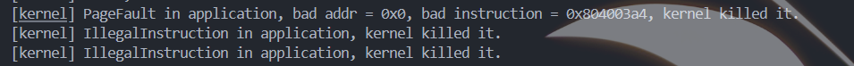
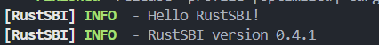

# 实现的功能

对于传入request为0或者1的实现较为简单

直接将_id转换为指针进行读或者写即可，注意下要用unsafe

对于2的实现较为复杂点，首先需要记录每个任务进行的系统调用次数，所以在任务的结构体新建了记录调用次数的数组，先设为411大小（测验貌似直到411，实际的系统调用似乎需要更多一点），接着初始化的时候初始数组为零。

接着新增TaskManager两个实现函数，一个为记录，一个为获取，具体实现在代码里，这里不在赘述。因为是定义了一个全局任务管理，所以需要定义两个对外接口，接口调用这个全局变量的内部函数，做到隔离解耦。

最后在syscall的mod里引入这个模块并每次进行系统调用前进行调用记录次数。

# 问答题

1. 三个案例分别报错，第一个是页错误，第二三个是错误指令。

   这表明在用户态执行内核态指令操作系统会报错，禁止越权操作，而直接读取或者写入s态寄存器会暴类似于页错误。

   此时内核会终止错误应用，但是其他任务照常执行。

   rustsbi为0.4.1

   

   

2 .问题

 	1. sp是在内核栈上，指向之前保存的用户态寄存器。通常是进入内核态后回到用户态需要切换一次上下文。
 	2. 中间的t0，t1，t2都是中间寄存器，因为不能直接将内存里的值加载到状态寄存器里，所以需要一个中转，对应的值分别是ssatus（恢复处理器的状态），sepc（设置sret后跳转的位置），sscratch（展示存放用户栈指针），这三个保存了进入用户态的信息。ssatus决定会到trap前后的状态，spec是储存进入trap前的下一段指令地址，用于返回。sscratch在这里是临时储存csr，用于储存。
 	3. x2还要用于读取上下文，所以应该是最后单独修改。x4本实验不设计调用，故不用恢复。
 	4. sp为返回用户态的栈指针，sscratch为内核态栈指针
 	5. sret，因为前面已经设置好了相关的状态，返回后直接进入用户态了。
 	6. 将sp设为内核态栈，sscratch为用户态栈，进行个地址互换的过程。
 	7. 触发ecall异常后由硬件完成U态到S态的切换。

1. 在完成本次实验的过程（含此前学习的过程）中，我曾分别与 **以下各位** 就（与本次实验相关的）以下方面做过交流，还在代码中对应的位置以注释形式记录了具体的交流对象及内容：

   > 在理解代码的过程中不懂地方向gpt以及gemini进行了相关询问。

2. 此外，我也参考了 **以下资料** ，还在代码中对应的位置以注释形式记录了具体的参考来源及内容：

   > 参考了rCore-Turorial-Guide文档

3. 我独立完成了本次实验除以上方面之外的所有工作，包括代码与文档。 我清楚地知道，从以上方面获得的信息在一定程度上降低了实验难度，可能会影响起评分。

4. 我从未使用过他人的代码，不管是原封不动地复制，还是经过了某些等价转换。 我未曾也不会向他人（含此后各届同学）复制或公开我的实验代码，我有义务妥善保管好它们。 我提交至本实验的评测系统的代码，均无意于破坏或妨碍任何计算机系统的正常运转。 我清楚地知道，以上情况均为本课程纪律所禁止，若违反，对应的实验成绩将按“-100”分计。

# 看法

对于零基础还是不很友好，特别好riscV的汇编代码，我觉得大部分人应该没有相关基础，一般都是x86的指令急，所以会有些吃力。对于文档整个过程感觉有点简略，比如一些一开始的启动流程例如引导之类的，没有很清楚的说明为什么要这样以及意义，估计是碍于篇幅。