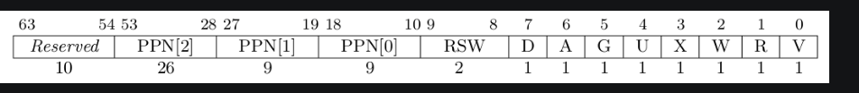

# 简单总结实现功能....

本实验在启用分页后重新实现了 `sys_get_time` 和 `sys_trace`：前者按页将时间写回用户缓冲区，后者根据用户页表检查权限后读写单字节，并支持查询当前任务的系统调用次数。同时实现了匿名 `mmap` 和 `munmap`，用于建立和解除用户页映射；解除映射时同步回收数据页帧并更新逻辑段记录。

# 问答题
1.

SV39的pte一共有64位，其中高十位充当保留位，紧接着是44位的ppn，在本实验用到的标志位有以下几种：

1. V：表示该页表项是否有效
2. RWX：分别代表是否可读，写，取值
3. U：是否运行U态进行访问

其余不常见的作用是：

- `G`：全局映射，地址翻译不局限于某个 ASID。
- `A`：访问位，表示该页自上次清零以来被访问过；有些硬件允许推测性地设置该位。
- `D`：脏位，表示该页自上次清零以来被写过。
- `RSW`：第 9–8 位，留给操作系统使用，硬件查页表时忽略。

2. 1. 访问未被分配的VA，缺页本质是进行了一次trap，所以所需要的寄存器会放进trapcontext，
   2. 可以在有必要的时候才进行map，避免了一些无意义的map，可以减少性能损失
   3. 10GiB/4kiB  *8约等于20miB
   4. 内核创建任务时不必要把所有内任务内存先进行映射，而是映射有必要的字段，比如text，rodata等
   5. pte的V段置0

3. 1. 更换satp CSR即可
   2. 标志位的U置0即可
   3. 避免频繁更换地址空间，这回刷新tlb降低性能
   4. 内核接管时需要切换页表，切换地址空间的时候

1. 在完成本次实验的过程（含此前学习的过程）中，我曾分别与 **以下各位** 就（与本次实验相关的）以下方面做过交流，还在代码中对应的位置以注释形式记录了具体的交流对象及内容：

   > **在理解代码的过程中不懂地方向gpt以及gemini进行了相关询问。

2. 此外，我也参考了 **以下资料** ，还在代码中对应的位置以注释形式记录了具体的参考来源及内容：

   > *参考了rCore-Turorial-Guide文档

3. 我独立完成了本次实验除以上方面之外的所有工作，包括代码与文档。 我清楚地知道，从以上方面获得的信息在一定程度上降低了实验难度，可能会影响起评分。

4. 我从未使用过他人的代码，不管是原封不动地复制，还是经过了某些等价转换。 我未曾也不会向他人（含此后各届同学）复制或公开我的实验代码，我有义务妥善保管好它们。 我提交至本实验的评测系统的代码，均无意于破坏或妨碍任何计算机系统的正常运转。 我清楚地知道，以上情况均为本课程纪律所禁止，若违反，对应的实验成绩将按“-100”分计。

